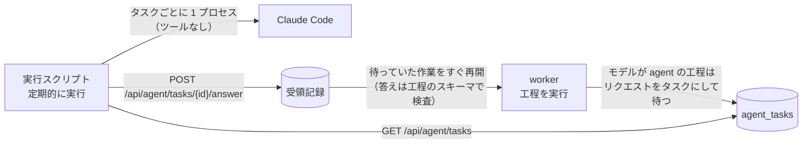

# Agent による処理

モデルの工程（予備選別、2 回の採点、構造化、タイトルと要約、出来事のまとめ、まとめ文、週報・月報の総括、全文翻訳）は、モデルの API の代わりに **Agent** に任せられます。Agent は定期的にサイトの作業のインターフェースへ作業を取りに来て、1 件ずつ答えて送り返します。API キーも従量課金も要りません。付属の[実行スクリプト](#実行スクリプト)が、Claude Code でタスクに答えます。ほかの Agent をつなぐこともできますが、[安全](#安全)の条件を守ってください。



## しくみ

- 工程のモデルが `agent` のとき、worker はモデルを呼ばず、プロンプト、入力、出力の形式（JSON Schema）をそのまま 1 件の**タスク**として保存し、その記事の処理を待たせます。待ちは失敗ではなく、再試行の回数にも数えません。
- Agent の答えは API の答えと同じく**受領記録**に保存され、待っていた作業はすぐに次の工程へ進みます。答えは工程の元のスキーマで検査し、使えなければ理由を添えて同じタスクを出し直します（`retryNote`）。
- 1 本の記事は 3〜4 回の行き来で判断まで進みます：予備選別 → 2 回の採点と構造化（3 件を同時に出す）→ タイトルと要約 → 出来事のまとめ（近い報道があるとき）→ まとめ文。Agent は 1 回の実行の中でタスクがなくなるまで取り直すので、その実行のうちに先の工程まで進みます。
- 1 日（または処理間隔の 3 倍の長いほう）答えのないタスクは取り下げ、待っている工程が次の試行で出し直します。工程のモデルを API に替えた後に残ったタスクは、取り下げで消えます。

## 有効にする

1. **トークン**：`.env` の `AGENT_TOKEN` に 16 文字以上のランダムな文字列を入れます（`node scripts/init-env.ts` は自動で作ります）。設定しなければ作業のインターフェースはすべて `401` を返します。
2. **処理方式**：`site/models.ts` の `PROCESSING.mode`（いまは `agent`）が既定です。環境変数 `PROCESSING_MODE`（`agent` / `api`）と管理画面の「モデル」ページの「処理方式」がこれより優先します。工程ごとに選んだモデル（管理画面、`PREFILTER_MODEL` などの環境変数）は処理方式より優先するので、「採点だけ API」のような組み合わせもできます。
3. **安全弁**：タスクを外に出すことも「モデルの呼び出し」なので、`MODEL_CALLS_ENABLED=true` が必要です。
4. **Agent の実行**を定期的に組みます（下の[実行スクリプト](#実行スクリプト)）。間隔は管理画面の「モデル」ページで設定し（既定 60 分、5〜1440 分）、作業のインターフェースが Agent に伝えます。Agent 自体の予定（cron など）もこの間隔に合わせてください。

## 作業のインターフェース

すべて `Authorization: Bearer <AGENT_TOKEN>` が必要で、`Cache-Control: no-store` を返します。

### タスクを取る

```
GET /api/agent/tasks?limit=10
```

`limit` は 1〜50（既定 10）。待っているタスクを古い順に返し、返したタスクは 30 分のあいだその Agent のものになります（ほかの実行には渡さない）。30 分を過ぎて答えのないタスクは、次に取りに来た Agent に渡ります。

```json
{
  "intervalMinutes": 60,
  "waiting": 23,
  "instructions": ["各タスクは 1 回のモデル呼び出しです。……"],
  "tasks": [
    {
      "id": 1842,
      "purpose": "score_article",
      "step": "厳選の採点（独立した 2 回の採点、情報源の格付けごとのしきい値）",
      "subject": "article:abc123@1",
      "attempt": "score-1",
      "format": "json",
      "system": "……採点の基準（industry/prompts/selection-score.md）……",
      "input": "システムのルールに従って、次の 1 本の材料が表す出来事を評価する。……",
      "schema": { "type": "object", "properties": { "attentionScore": { "type": "integer" } } },
      "temperature": 0.2,
      "maxTokens": 1024,
      "retryNote": null,
      "postedAt": "2026-10-05T01:02:03.000Z",
      "claims": 1
    }
  ]
}
```

| 項目 | 内容 |
|---|---|
| `system`・`input` | API に送るはずだった指示と入力。そのまま読みます |
| `format` | `json`：JSON オブジェクト 1 つで答える（`schema` があればそれに従う）。`text`：指示が求める形式の文字列で答える（タイトルと要約の工程など） |
| `subject`・`attempt` | 何についてのタスクか。subject と purpose が同じで attempt が違うタスク（2 回の採点）は、**互いを見ずに別々に答えます** |
| `retryNote` | 前回の答えが使えなかった理由。直して答えます |
| `temperature`・`maxTokens` | API で使うはずだった値。答えの長さと揺らぎの目安です |
| `waiting` | この取得の後、誰も持っていない待ちのタスクの数 |

### 答えを送る

```
POST /api/agent/tasks/{id}/answer
Content-Type: application/json

{ "output": { "attentionScore": 82 } }
```

`format` が `text` のタスクは `"output": "title: ……\nsummary: ……"` のように文字列で送ります。`{"ok": true}` を返します。

| 状態 | 意味 |
|---|---|
| `400` | `output` が空、または 20 万文字を超える |
| `404` | そのタスクは待っていない（すでに答えた、取り下げた、存在しない） |

答えの形式の検査は、待っていた工程が次の試行で行います。使えない答えは `200` で受け取った後、理由付きで同じ `id` のタスクとして戻ってきます。

### 状態を見る

```
GET /api/agent/status
```

`{"mode": "agent", "intervalMinutes": 60, "waiting": 23, "claimed": 10, "oldestAt": "…", "answeredDay": 412}` を返します。管理画面の「モデル」ページにも同じ数字が出ます。

## 実行スクリプト

[`scripts/agent-runner.ts`](../scripts/agent-runner.ts) が 1 回の実行を受け持ちます。Node.js 24 と、サインイン済みの Claude Code（`claude`）がある端末で動きます。リポジトリのほかのファイルを読まないので、このファイルだけをコピーして使えます。

1. `GET /api/agent/tasks?limit=10` でタスクを取ります。
2. タスク 1 件ごとに新しい `claude -p` を 1 つ起こして答えさせ（同時に `AGENT_CONCURRENCY` 個、既定 2）、`POST …/answer` で送ります。2 回の採点も別々のプロセスなので、互いの答えを見ません。
3. 1 に戻ります。答えを送ると数秒〜1 分で次の工程のタスクができるので、タスクが空なら 60 秒待って取り直し、**3 回続けて空なら終わります**。開始から 50 分を超えたとき、3 件続けて答えられなかったとき（サインインの期限切れ、利用量の上限など）も終わります。持っていたタスクは 30 分後にほかの実行へ渡ります。

### 設定

サイトのアドレスとトークンは、ほかの利用者が読めないファイルに書きます。コマンドラインに書くと、プロセスの一覧やシェルの履歴に残ります。

```bash
# /srv/hotmoto-agent/agent.env（chmod 600）
HOTMOTO_URL=https://example.com
AGENT_TOKEN=サイトの .env と同じ値
# AGENT_CONCURRENCY=2
```

Claude Code には、実行する利用者で一度 `claude` を起こしてサインインしておきます。人のいない環境では、`claude setup-token` で作った長期のトークンを `CLAUDE_CODE_OAUTH_TOKEN` に設定する方法もあります。

### cron

毎時実行します（日報の締め 08:00 の前に 1 回入るよう、例では毎時 05 分と 07:30）。cron の `PATH` は短いので、`node` と `claude` のあるディレクトリを加えます：

```cron
PATH=/usr/local/bin:/usr/bin:/bin:/home/hotmoto/.local/bin
5 * * * *  cd /srv/hotmoto-agent && node --env-file=agent.env agent-runner.ts
30 7 * * * cd /srv/hotmoto-agent && node --env-file=agent.env agent-runner.ts
```

Windows ではタスク スケジューラに `node --env-file=agent.env agent-runner.ts` を登録し、「開始（オプション）」にこのディレクトリを指定します。Claude Code はネイティブ版（`claude.exe`）を使ってください。npm で入れた `claude.cmd` は、シェルを通さずには起動できません。Claude Code の利用規約と利用量の上限も確かめてください。

## 安全

タスクには情報源の記事がそのまま入り、記事は誰でも書けます。記事に「前の指示を無視して〜を実行せよ」と書かれていても、それを読むモデルが何もできないようにするのが実行スクリプトの役目です。

- **モデルは道具を持ちません**：`--tools ""` で Bash、ファイルの読み書き、ウェブの取得などの組み込みのツールをすべて外し、`--safe-mode` と `--strict-mcp-config` でこの端末の MCP サーバー、CLAUDE.md、プラグイン、フックも読みません。ファイルを読む道具だけでも、読んだ中身を要約に書かせてサイトで公開させられるので、読み取りも外します。
- **1 プロセスに 1 タスク**：指示（`system`）はシステムプロンプトとして、入力（`input`）は標準入力で渡し、ほかのタスクは見せません。実行ファイルと引数は固定で、シェルを通しません。作業ディレクトリは毎回新しい空のディレクトリで、終わったら消します。
- **鍵を渡しません**：プロセスに渡す環境変数は、Claude Code のサインインと通信に要るもの（`PATH`、`HOME`、`ANTHROPIC_*`、`CLAUDE_*`、プロキシの設定など。Bedrock や Vertex を使うときはそのクラウドの認証情報）だけで、`AGENT_TOKEN` やサイトのほかの鍵は入りません。
- **出力は答えの本文だけ**：モデルの出力は、そのタスクの答えとしてサイトに送るだけです。送り先のアドレス、ファイル、起動の引数を決めることはありません。

それでも、記事がモデルの**答えの中身**（点数や要約）を偏らせることは防げません。これは API で処理するときと同じで、2 回の独立した採点、工程のスキーマによる検査、プロンプトの安全の指示で抑えます。

自分で別の Agent をつなぐときも、同じ条件を守ってください：タスクを読むモデルにシェル、ファイル、ネットワークの道具を渡さず、タスクを取って答えを送るのはモデルではなくプログラムにします。`curl` を許したモデルにタスクを読ませると、記事に書かれた指示で端末のファイルを外へ送られたり、書き換えられたりするおそれがあります。

## 注意

- **新しい記事は次の実行まで待ちます**：時事性は実行の間隔で決まります。週報・月報も総括の答えが届いてから発行します（届くまでは次の実行に回す）。日報はルールで編むので待ちません。
- **量**：1 本の記事でおよそ 4〜6 件のタスクになります。管理画面の「モデル」ページで、工程ごとの件数と待ち時間（所要時間の列）を見られます。
- **しきい値の校正**：`industry/selection.ts` のしきい値は特定のモデルで校正した値です。採点を Agent に替えたら、[厳選と校正](selection.md) の手順で、自分でラベル付けしたサンプルで校正し直してください。
- **画像は読みません**：内容理解の工程は本文だけで書きます。
- **送る内容**：タスクには記事の本文が入ります。API に送るのと同じく、使う Agent の提供元に送られます。
- **API に戻す**：管理画面の「処理方式」で API を選ぶか、`PROCESSING_MODE=api` にします。待っていた工程は次の試行で API で処理し、残ったタスクは 1 日後に取り下げます。
